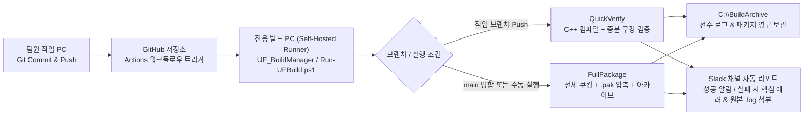

<div align="center">

# 🛠️ BuildServerKit (`UE_BuildManager`)

**전용 빌드 PC에서 버튼 클릭만으로 운영하는 Unreal Engine 5 자동 빌드 · 패키징 · GitHub Actions Self-Hosted Runner · Slack 실시간 에러 리포트 올인원 GUI 매니저**

[-0078D6?style=flat-square&logo=windows&logoColor=white)](https://github.com/eruminyu/BuildServerKit)
[](https://www.unrealengine.com/)
[](https://docs.github.com/en/actions/hosting-your-own-runners)
[](https://api.slack.com/)
[](./UE_BuildManager.cs)
[](./LICENSE)

[📦 **최신 릴리즈(실행 파일 패키지) 다운로드**](https://github.com/eruminyu/BuildServerKit/releases/latest) · [📖 **단계별 세팅 가이드**](#-2-처음-시작하기-단계별-가이드) · [🧹 **클린 배포 초기화 안내**](#-3-프로그램을-다른-곳으로-배포할-때-데이터-초기화)

</div>

---

## 💡 소개

언리얼 엔진(Unreal Engine 5) 팀 프로젝트에서 **개별 작업 PC로 무거운 C++ 컴파일과 쿠킹·패키징을 돌리기 부담스러울 때**, 남는 전용 PC 한 대를 **포트포워딩이나 복잡한 CI 서버(Jenkins 등) 구축 없이** 버튼 클릭만으로 자동화된 빌드 서버로 만들어 주는 올인원 도구입니다.

* **⚡ 무설치 단일 실행 파일 (`UE_BuildManager.exe`)**: Windows 기본 내장 .NET Framework 4.x 기반으로 작동하여 별도 런타임 설치 없이 더블클릭으로 즉시 실행됩니다.
* **🔗 GitHub 웹 로그인 & 저장소 선택 마법사**: 브라우저 또는 GitHub CLI(`gh`)로 로그인해 내 계정의 Public / Private / Organization 저장소 목록을 불러오고 클릭 한 번으로 연결합니다.
* **🐙 GitHub Actions Self-Hosted Runner 원클릭 구축**: 최신 Runner 다운로드부터 **GitHub API를 통한 Runner 등록 토큰 자동 발급 및 등록**, 백그라운드 가동까지 버튼 클릭만으로 끝납니다.
* **📂 `.gitignore` 제외 대용량 에셋 자동 정션(심볼릭 링크) 연결**: Git 용량 문제로 `.gitignore`에 제외해 둔 `Content/...` 하위 에셋 폴더들을 자동으로 스캔해 `C:\BuildSystem\SharedAssets` 원본과 즉시 심볼릭 링크(`mklink /J`)로 연결합니다.
* **🚨 실시간 에러 발췌 & Slack 원본 `.log` 파일 자동 첨부**: 빌드/패키징 중 에러가 발생하면 C++ 컴파일 에러(`error C...`), 쿠킹 실패, `Ensure` 스택트레이스 핵심 라인만 발췌해 Slack 코드블록으로 쏘고, **전체 원본 `.log` 파일을 Slack 채팅방에 바로 첨부 업로드**합니다.
* **🔤 완벽한 한글 인코딩 호환 (`UTF-8 / CP949 스마트 디코더`)**: `git`·`RunUAT`의 UTF-8 출력과 Windows `cmd.exe`·MSVC `cl.exe`(C++ 컴파일러)의 CP949(EUC-KR) 한글 출력을 줄 단위로 자동 감지해 글자 깨짐 없이 실시간 콘솔에 출력합니다.
* **🧹 잔여 데이터 0% 클린 배포 설계 (`Factory Reset`)**: 처음 실행 시 어떠한 개인/프로젝트 데이터도 남아있지 않으며, 다른 PC나 팀에 재배포할 때 **`[[초기화] 배포용 데이터 비우기]`** 버튼 하나로 모든 설정과 토큰을 깨끗이 비울 수 있습니다.

---

## 🔄 전체 자동화 파이프라인 구조



---

## 📦 1. 폴더 내 파일 구성

전용 빌드 PC에 배포할 때는 **[Releases](https://github.com/eruminyu/BuildServerKit/releases/latest)**에서 압축 파일을 내려받거나, 이 저장소를 Clone하여 사용하시면 됩니다.

| 파일명 | 역할 및 설명 |
| :--- | :--- |
| **`UE_BuildManager.exe`** | **(메인 실행 파일)** 별도 런타임 설치 없이 Windows에서 더블클릭으로 즉시 실행되는 GUI 매니저 |
| **`github_workflow_build.yml`** | 연결할 언리얼 GitHub 저장소의 `.github/workflows/build.yml`에 등록할 자동화 워크플로우 템플릿 |
| **`Run-UEBuild.ps1`** | GitHub Actions Runner가 호출하는 언리얼 빌드·쿠킹·패키징 및 로그 전수 수집 스크립트 (`*.uproject` 및 `.gitignore` 제외 에셋 자동 감지) |
| **`Send-SlackReport.ps1`** | 빌드 실패 시 핵심 에러 라인 추출 및 Slack 채널로 메시지·원본 `.log` 첨부파일을 업로드하는 스크립트 |
| **`Init-BuildPC.ps1`** | 전용 PC 초기 폴더 구조를 파워셸에서 한 번에 생성할 때 사용하는 보조 스크립트 (GUI 내 버튼으로도 동일하게 실행 가능) |
| **`UE_BuildManager.cs`** | GUI 프로그램의 C# 원본 소스 코드 (단일 파일, 외부 패키지 의존성 없음) |
| **`compile.bat`** | 소스 코드(`UE_BuildManager.cs`) 수정 후 더블클릭 한 번으로 `UE_BuildManager.exe`를 재컴파일하는 스크립트 |
| **`build_manager_config.example.json`** | 런타임 설정 파일(`build_manager_config.json`)의 구조 예시 파일 |

---

## 🚀 2. 처음 시작하기 (단계별 가이드)

### Step 1. GitHub 웹 로그인 및 사용할 저장소(Repository) 연결
1. **`UE_BuildManager.exe`**를 더블클릭하여 실행합니다.
2. 좌측 상단 **`[■ 0. GitHub 로그인 & 저장소 연결]`** 섹션의 **`[▶ GitHub 로그인 & 사용할 저장소 선택하기]`** 버튼을 클릭합니다.
3. 팝업 창이 열리면 **`[▶ 1. GitHub 웹 로그인 & 연동 토큰 발급 페이지 열기]`** 버튼을 클릭합니다.
   * 웹 브라우저가 열리면서 GitHub 로그인 화면(이미 로그인된 경우 토큰 생성 화면)으로 이동하며, 필요한 권한(`repo`, `workflow`, `read:org`)이 자동으로 체크되어 있습니다.
   * 페이지 하단의 **`Generate token`**을 눌러 발급된 토큰(`ghp_...`)을 복사합니다.
   * *(참고: PC에 GitHub CLI `gh`가 설치되어 있다면 우측의 `[★ GitHub CLI(gh)가 설치된 경우 브라우저 원클릭 로그인]` 버튼으로도 즉시 연동할 수 있습니다.)*
4. 복사한 토큰을 팝업 창의 `GitHub 인증 토큰` 칸에 붙여넣고 **`[▶ 2. 로그인 및 내 저장소 불러오기]`** 버튼을 클릭합니다.
5. 내 계정으로 접근 가능한 모든 저장소(개인/팀/Organization, Public/Private) 목록이 표시되면, **사용할 언리얼 프로젝트 저장소를 선택**하고 하단의 **`[✔ 선택한 저장소를 빌드매니저에 연결하기]`** 버튼을 누릅니다.
   * 연결 즉시 해당 저장소의 **원격 브랜치 목록**이 메인 화면 드롭다운에 자동으로 불러와지며, 워크스페이스 경로도 `C:\BuildSystem\Workspace\<저장소이름>`으로 자동 세팅됩니다.

---

### Step 2. 전용 PC 초기 폴더 생성 & 저장소 Clone & 제외 에셋 연결
좌측 하단 **`[■ 3. 전용 PC 초기 세팅 & 제외 에셋 연결]`** 섹션의 버튼을 순서대로 클릭합니다.

1. **`[[1] 필수 폴더 구조(BuildSystem/Archive) 생성]`** 클릭
   * `C:\actions-runner`, `C:\BuildSystem\Scripts`, `C:\BuildSystem\Workspace`, `C:\BuildSystem\SharedAssets`, `C:\BuildArchive\Logs`, `C:\BuildArchive\Packages` 폴더가 일괄 생성되고 파워셸 스크립트가 배치됩니다.
2. **`[[2] 연결된 저장소를 워크스페이스에 최초 Clone]`** 클릭
   * Step 1에서 연결한 GitHub 저장소를 전용 PC의 워크스페이스 폴더로 클론합니다 (Private 저장소도 로그인된 계정 권한으로 자동 클론됩니다).
3. **`.gitignore` 제외 에셋 원본 복사 및 심볼릭 링크 연결**
   * 만약 프로젝트의 `.gitignore`에 `Content/...` 형태로 Git 추적에서 제외된 대용량/라이선스 에셋 폴더(예: `Content/Assets/Release`, `Content/ThirdParty` 등)가 있다면, 프로그램이 `.gitignore`를 자동으로 스캔하여 감지합니다.
   * **`[제외 에셋 원본(SharedAssets) 폴더 열기]`** 버튼을 눌러 열린 `C:\BuildSystem\SharedAssets` 폴더 안에 제외된 에셋 폴더 원본들을 최초 1회 복사해 넣습니다.
   * **`[[3] .gitignore 제외 에셋 자동 스캔 & 심볼릭 링크 연결]`** 버튼을 클릭하면 프로젝트 `Content` 폴더 내부로 정션(심볼릭 링크)이 자동 생성되며 상태 표시줄이 `● 모두 연결됨`으로 바뀝니다.

---

### Step 3. GitHub Actions (Self-Hosted Runner) 원클릭 설치 및 가동
전용 PC가 포트포워딩 없이도 GitHub 커밋 신호를 즉시 받아 자동 빌드를 수행하도록 설정합니다. 좌측 중앙 **`[■ 2. GitHub Actions Runner 원클릭 제어]`** 섹션을 사용합니다.

1. **`[[1] GitHub Runner 자동 다운로드 & 설치]`** 클릭
   * GitHub 공식 최신 Windows x64 Runner 패키지를 자동으로 다운로드하고 `C:\actions-runner`에 압축을 해제합니다.
2. **`[[2] 연결된 저장소에 이 PC를 Runner로 자동 등록]`** 클릭
   * Step 1에서 로그인한 GitHub 계정 권한을 사용하여 **Runner 등록 토큰을 API로 자동 발급**받고, 전용 PC를 연결된 저장소의 Self-Hosted Runner로 즉시 등록합니다. (별도로 웹에서 등록 토큰을 복사해 올 필요가 없습니다.)
3. **`[▶ Runner 가동 시작]`** 클릭
   * 상태가 **`● Runner 상태: 작동 중 (GitHub 커밋 대기/수신 중)`**으로 바뀌며 백그라운드에서 커밋 감지를 시작합니다.
4. **저장소의 원하는 브랜치에 워크플로우 파일(`.github/workflows/build.yml`) 원클릭 등록 & 스캔**
   * **원클릭 자동 등록:** 좌측 `대상 브랜치:`에서 원하는 브랜치를 선택하고 **`[★ 선택한 브랜치에 build.yml 원클릭 자동 커밋(Push)]`** 버튼을 누르면, 수동으로 파일을 복사할 필요 없이 프로그램이 GitHub API로 해당 브랜치에 `.github/workflows/build.yml`을 즉시 커밋·Push합니다.
   * **특정 브랜치 `build.yml` 감지 확인:** 이미 특정 작업 브랜치에 직접 `build.yml`을 커밋해 두셨다면 **`[▶ 모든 브랜치 build.yml 유무 & Actions 감지 스캔]`** 버튼을 클릭하세요. 저장소 내 모든 원격 브랜치를 스캔하여 어느 브랜치에 `build.yml`이 있는지 찾아내고 해당 브랜치로 자동 전환하며, 최근 GitHub Actions 대기(`queued`)/실행 상태를 실시간으로 표시합니다.
   * **자동 분기 동작 방식:**
     * 일반 작업 브랜치에 Push 할 때 ➔ **빠른 검증 빌드(`QuickVerify` : C++ 컴파일 + 증분 쿠킹 검사)** 자동 실행
     * `main` 브랜치에 병합(Push)하거나 GitHub 웹의 `Actions` 탭에서 수동 실행(`Run workflow`)할 때 ➔ **전체 패키징 빌드(`FullPackage` : 전체 쿠킹 + `.pak` 압축 + 아카이브 추출)** 실행

---

### Step 4. Slack 봇 연동 (에러 발생 시 작업 PC로 즉시 로그 & 파일 전송)
빌드 완료 알림과 에러 발생 당시의 핵심 에러 코드블록 및 원본 `.log` 파일을 Slack으로 바로 받기 위한 설정입니다.

1. **[Slack API 앱 관리 페이지 (api.slack.com/apps)](https://api.slack.com/apps)** 접속 ➔ **`Create New App`** ➔ **`From scratch`** 선택 후 앱 생성
2. 좌측 메뉴 **`OAuth & Permissions`** 이동 ➔ **`Bot Token Scopes`** 항목에 아래 2개 권한 추가:
   * `chat:write` (메시지 및 에러 요약 코드블록 전송 권한)
   * `files:write` (에러 원본 `.log` 파일 첨부 업로드 권한)
3. 페이지 상단 **`Install to Workspace`** 클릭 후 발급된 **`Bot User OAuth Token (xoxb-...)`** 복사
4. 알림을 받을 Slack 채널에서 `/invite @생성한봇이름`으로 봇을 초대한 뒤, 채널 우클릭 ➔ **`채널 세부정보 보기`** 맨 아래에서 **채널 ID (예: `C0123456789`)** 복사
5. 빌드매니저 우측 **`[[3] 경로 & GitHub Actions / Slack 설정]`** 탭에 `Slack Bot Token`과 `Slack 채널 ID`를 입력하고 **`[✔ 모든 설정 저장]`** 클릭 후 **`[Slack 연동 테스트 메시지 보내기]`**로 정상 수신을 확인합니다.

---

### Step 5. 원격 접속(Tailscale) 및 결과물/로그 폴더 네트워크 공유
팀원들이 각자 다른 장소(집/연구실 등)에서도 완성된 패키징 파일과 전체 과거 로그에 접근할 수 있도록 세팅합니다.

1. 전용 PC와 팀원들의 PC에 **[Tailscale](https://tailscale.com/)**을 설치하고 로그인합니다.
2. 빌드매니저의 **`[[3] 설정]`** 탭에서 **`[이 PC의 Tailscale IP(100.x.y.z) 자동 감지]`** 버튼을 누르면 전용 PC의 가상 내부망 IP가 자동으로 입력됩니다.
3. 전용 PC의 `C:\BuildArchive` 폴더를 우클릭 ➔ `속성` ➔ `공유` 탭에서 Windows 네트워크 공유를 활성화합니다.
4. 이제 모든 팀원은 본인 작업 PC의 파일 탐색기 주소창에 `\\전용PC_Tailscale_IP\BuildArchive`를 입력하여 모든 빌드 로그(`Logs`)와 패키징 결과물(`Packages`)을 내 컴퓨터 폴더처럼 열람할 수 있습니다.

---

## 🧹 3. 프로그램을 다른 곳으로 배포할 때 (데이터 초기화)

설정을 마치고 테스트해 본 뒤, 이 프로그램 폴더를 다른 PC나 다른 팀에 배포할 때는 **내 토큰이나 연결했던 저장소 정보가 남아있지 않도록** 아래 절차만 실행하시면 됩니다.

1. 프로그램 우측 상단(또는 `[[3] 설정]` 탭 하단)의 **`[[초기화] 배포용 데이터 비우기]`** 버튼을 클릭합니다.
2. 확인 창에서 **`예(Y)`**를 누르면 로컬에 생성된 `build_manager_config.json` 파일과 메모리에 로드된 모든 GitHub 계정/저장소/브랜치/Slack 토큰 정보가 완전히 삭제됩니다.
3. 프로그램을 종료한 뒤 폴더를 압축하여 배포하시면 됩니다.

---

## 🛠️ 소스 코드에서 직접 빌드하기

별도의 Visual Studio나 무거운 SDK를 설치할 필요 없이, Windows 10/11에 기본 내장된 .NET Framework C# 컴파일러(`csc.exe`)를 사용해 즉시 빌드할 수 있습니다.

```cmd
:: 더블클릭 또는 터미널에서 실행
compile.bat
```

---

## 📄 라이선스

이 프로젝트는 [MIT License](./LICENSE)에 따라 배포됩니다.
