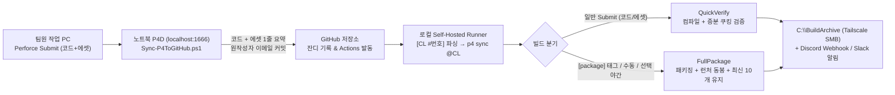

<div align="center">

# 🛠️ BuildServerKit Studio `v2.1.0`

**Unreal Engine 5 전용 빌드 PC / 노트북 올인원 자동화 매니저 — Perforce 하이브리드 미러링 · GitHub Actions Self-Hosted Runner · 패키지 자동 보관 정리 · Discord/Slack 리포트 · Tailscale 원격 웹 대시보드**

[-0078D6?style=flat-square&logo=windows&logoColor=white)](https://github.com/eruminyu/BuildServerKit)
[](https://www.unrealengine.com/)
[](./PERFORCE_SETUP_GUIDE.md)
[](./app)
[](./LICENSE)

[📘 **노트북 올인원 Perforce 세팅 가이드**](./PERFORCE_SETUP_GUIDE.md) · [🚀 **빠른 시작**](#-빠른-시작) · [📦 **파일 구성**](#-폴더-내-파일-구성)

</div>

---

## ✨ v2.0 주요 기능

* **✨ 최초 실행 설정 마법사 & PC 필수 요소 자동 진단**: 새 PC에서 처음 실행하면(또는 배포용 `Factory Reset` 후 첫 실행 시) **5단계 설정 마법사**가 자동 실행되어 **Unreal Engine 5(버전 자동 탐색) · Visual Studio C++(MSVC) · Git · Perforce(CLI/P4D) · Tailscale · RAM/SSD 용량 · Runner** 상태를 실시간 진단하고, 부족한 요소는 공식 다운로드 또는 **`winget` 원클릭 설치**로 바로 보완할 수 있습니다. 이후에도 좌측 하단/대시보드의 **`[✨ 설정 마법사]`** 버튼으로 언제든 다시 열 수 있습니다.
* **⚡ Perforce GUI 설치 & 원클릭 서버 자동 세팅 (터미널 불필요)**: `[Perforce & 미러링]` 탭에서 최신 Helix Core Server(`P4D`) 자동 다운로드·설치, `winget` `Perforce.P4V`(P4V+CLI) 설치, UAC Unicode 전환(`p4d -xi`), 방화벽 개방(`1666`/`3780`), GUI 관리자 로그인, 그리고 **Stream 디포 · UE5 Typemap(`+l`) · Read-Only `p4bot` 무기한 티켓 · 전용 워크스페이스 2개 · `.p4ignore` 원클릭 일괄 구성**을 모두 지원합니다.
* **👥 팀원 & 계정 관리 탭 (GitHub 프로필 링크 자동 채우기)**: GitHub 프로필 URL(`https://github.com/<아이디>`)만 붙여넣으면 아바타·이름·잔디용 이메일(비공개 시 공식 `{id}+{login}@users.noreply.github.com` 자동 생성)을 채워 **Perforce 계정 생성/수정 + `author_map.json` 저장 + 팀원용 P4V 접속 가이드 복사**까지 한 번에 처리하며, 무료 플랜 5유저/20워크스페이스 한도와 임의 유저 자동생성 차단(`dm.user.noautocreate=2`)을 실시간 관리합니다.
* **🎨 모던 Electron 데스크톱 앱 (`BuildServerKit Studio`)**: 커스텀 프레임리스 다크 UI, 시스템 트레이 상주, 실시간 컬러 빌드 콘솔 + 자동 에러 발췌 패널, 디스크·패키지 용량 게이지.
* **🧹 클린 배포(Distribution-First) 설계**: 포터블 단일 실행 파일(`BuildServerKit_Studio_Portable.exe`) 내부에는 개인 토큰·로컬 설정이 일절 포함되지 않으며, UE5 경로·Tailscale IP를 대상 PC에서 자동 감지합니다. 다른 팀에 배포 전 `[알림 · 네트워크 · 설정]`의 **`Factory Reset`**을 누르면 `SetupCompleted`가 초기화되어 다음 PC에서 마법사가 자동 시작됩니다.
* **🌐 선택적 Tailscale 원격 웹 대시보드**: 앱 내장 HTTP/SSE 서버를 토글 한 번으로 켜면 팀원들이 원격 데스크톱 없이 브라우저(`http://<TailscaleIP>:3780`)에서 실시간 빌드 상태·콘솔·에러·패키지 목록을 열람할 수 있습니다 *(기본 읽기 전용, 모든 토큰·설정 원격 노출 차단)*.
* **🔄 Perforce 하이브리드 + Git 단독 듀얼 모드**:
  * **Perforce → GitHub 자동 미러링 (`Sync-P4ToGitHub.ps1`)**: 워터마크 순차 처리로 CL 유실 없이 코드만 추출·Push하며, **아티스트의 에셋 Submit도 `.p4-sync/asset_changelog.md`에 1줄 요약으로 기록**해 원작성자 GitHub 잔디와 자동 쿠킹 검증(`QuickVerify`)을 보장합니다.
  * **로컬 초고속 패키징 (`github_workflow_p4_build.yml`)**: 커밋의 `[CL #번호]`를 파싱해 `localhost:1666` 로컬 Perforce에서 코드+에셋 전체를 동기화해 패키징합니다.
  * **P4 정기 백업 (`Backup-P4Server.ps1`)**: 새벽 `p4 admin checkpoint` + `robocopy`/`rclone` 외부 복제 + 구형 체크포인트 정리.
* **📦 패키징 빌드 보관 개수 제한 (기본 10개)**: GUI의 **사용함 / 사용안함 토글 + 유지 개수 조절**로 전체 패키징 성공 시 최신 N개만 유지하고 가장 오래된 패키징부터 자동 삭제합니다 *(GUI 수동 빌드 및 GitHub Actions `Run-UEBuild.ps1` 양쪽 동일 적용)*.
* **💬 Discord Webhook & Slack 동시 지원**: 성공/실패 Embed 리포트 + 실패 시 핵심 에러 발췌 및 원본 `.log` 자동 첨부 *(Discord 8MB 초과 시 자동 `.zip` 압축)*.
* **🎮 30KB 초경량 게임 옵션 런처 (`_Launcher.exe`) 자동 동봉**: 패키징 게임 폴더에는 기존 C# 기반 초경량 런처 빌더(`UE_BuildManager.exe --make-launcher`)를 그대로 유지해 생성합니다.

---

## 🔄 Perforce 하이브리드 파이프라인 흐름



---

## 📦 폴더 내 파일 구성

| 파일 / 폴더 | 역할 |
| :--- | :--- |
| **`app/`** | **BuildServerKit Studio** Electron 데스크톱 앱 + 내장 Tailscale 원격 웹 대시보드 소스 |
| **`launch_app.bat`** | 더블클릭 한 번으로 의존성 자동 확인 후 BuildServerKit Studio 실행 |
| **`build_app.bat`** | Windows 포터블 단일 실행 파일(`BuildServerKit_Studio_Portable.exe`) 패키징 스크립트 |
| **`PERFORCE_SETUP_GUIDE.md`** | 32GB/1TB 노트북 올인원 P4D · `p4bot` · Typemap · 워크스페이스 단계별 세팅 가이드 |
| **`Sync-P4ToGitHub.ps1`** | 워터마크 기반 P4 → GitHub 코드 & 에셋 1줄 요약 자동 미러링 스크립트 |
| **`github_workflow_p4_build.yml`** | Perforce 하이브리드 전용 GitHub Actions 워크플로우 템플릿 (야간 빌드 선택 옵션 포함) |
| **`github_workflow_build.yml`** | 기존 Git 단독 모드용 GitHub Actions 워크플로우 템플릿 |
| **`Run-UEBuild.ps1`** | UE5 빌드·쿠킹·패키징 + 패키지 보관 개수 자동 정리 + 런처 동봉 + 알림 호출 스크립트 |
| **`Send-DiscordReport.ps1`** | Discord Webhook Embed + 실패 시 원본 `.log`/`.zip` 첨부 업로드 스크립트 |
| **`Send-SlackReport.ps1`** | Slack Bot 메시지 + 실패 시 원본 `.log` 첨부 업로드 스크립트 |
| **`Backup-P4Server.ps1`** | Perforce 새벽 체크포인트 생성 + 외부 스토리지 복제 + 구형 파일 정리 스크립트 |
| **`Init-BuildPC.ps1`** | `C:\BuildSystem` / `C:\BuildArchive` 초기 폴더 생성 및 스크립트 일괄 배치 |
| **`author_map.example.json`** | P4 사용자 ID ↔ GitHub 이메일 예외 매핑 테이블 예시 |
| **`build_manager_config.example.json`** | GUI · Actions · 미러링 스크립트가 공유하는 통합 설정 구조 예시 |
| **`UE_BuildManager.exe` / `.cs`** | 게임 패키징 동봉용 30KB 초경량 `_Launcher.exe` 생성기 (및 레거시 WinForms 매니저) |

---

## 🚀 빠른 시작

1. **앱 실행:**
   ```cmd
   launch_app.bat
   ```
   *(Node.js 설치 환경에서 최초 실행 시 자동으로 `npm install` 후 Electron 앱이 실행됩니다. 배포용 포터블 `.exe`가 필요하면 `build_app.bat`을 실행하세요.)*
2. **Perforce 올인원 신규 세팅:** [`PERFORCE_SETUP_GUIDE.md`](./PERFORCE_SETUP_GUIDE.md) 순서대로 1회 세팅하면 완료됩니다.
3. **기존 Git 단독 모드로 사용 시:** `[Perforce & 미러링]` 탭 우측 상단에서 **`Git 단독 모드`**를 선택하면 기존과 동일하게 동작합니다.

---

## 📄 라이선스

[MIT License](./LICENSE)
