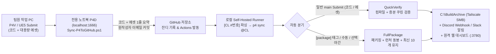

<div align="center">

# 🛠️ BuildServerKit Studio `v2.3.0`

**여유 노트북(또는 전용 PC) 1대를 클릭 몇 번으로 Unreal Engine 5 올인원 빌드 서버로 만들어 주는 데스크톱 매니저**  
*Perforce 하이브리드 자동 미러링 · GUI 원클릭 P4 서버 세팅 · GitHub Actions Self-Hosted Runner · 팀원 GitHub 프로필 연동 · 패키지 자동 보관 정리 · Discord/Slack 리포트 · Tailscale 원격 웹 대시보드*

[](https://github.com/eruminyu/BuildServerKit/releases/latest)
[-0078D6?style=flat-square&logo=windows&logoColor=white)](https://github.com/eruminyu/BuildServerKit/releases/latest)
[](https://www.unrealengine.com/)
[](./PERFORCE_SETUP_GUIDE.md)
[](./LICENSE)

[📦 **최신 `.exe` 다운로드**](https://github.com/eruminyu/BuildServerKit/releases/latest) · [⚡ **자동 빌드 조건**](#-자동-빌드-분기-조건-quickverify-vs-fullpackage) · [🚀 **초기 세팅 튜토리얼**](#-단계별-초기-세팅-튜토리얼-설정-마법사-기준) · [👥 **팀원 합류 가이드**](#-팀원-pc클라이언트-합류-가이드--일상-루틴) · [🔧 **실전 트러블슈팅 FAQ**](#-자주-겪는-문제--10초-해결법-실전-faq)

</div>

---

## 💡 소개 & 전체 자동화 파이프라인

언리얼 엔진 5 팀 프로젝트에서 **대용량 바이너리 에셋(`.uasset`, `.umap`)은 로컬 Perforce로 안전하게 잠금 관리(`+l`)하고, 소스 코드·에셋 변경 요약은 GitHub로 자동 미러링(잔디 반영)해 로컬 초고속 패키징과 알림까지 연결**해 주는 올인원 도구입니다. *(기존 Git 단독 프로젝트 모드도 그대로 지원합니다.)*



---

## ⚡ 자동 빌드 분기 조건 (`QuickVerify` vs `FullPackage`)

| 상황 / 트리거 | 실행되는 모드 | 설명 |
| :--- | :---: | :--- |
| **평소 `//프로젝트/main` Submit / 병합** | ⚡ **`QuickVerify`** | C++ 컴파일 + 변경된 에셋만 증분 쿠킹(`-iterate -skipstage`). `.pak` 생성을 생략해 1TB SSD 수명·시간을 보호하며, 연속 Submit 시 최신 CL만 검증합니다. |
| **Submit 메시지에 `[package]` 또는 `[release]` 포함** | 📦 **`FullPackage`** | 예: `[package] 1차 플레이테스트 빌드` → 전체 맵 쿠킹 + `.pak` 패키징 + 30KB 옵션 런처 동봉 → `C:\BuildArchive\Packages\` 보관(최신 N개 유지). 도중에 새 Submit이 와도 취소되지 않고 끝까지 완주합니다. |
| **GitHub Actions 수동 실행 (`Run workflow`)** | 🎛️ **직접 선택** | 기본값 `FullPackage` *(드롭다운에서 `QuickVerify`, 특정 `target_cl`, 빌드 구성 선택 가능)* |
| **BuildServerKit 앱 대시보드 버튼** | 🎛️ **누른 버튼 즉시 실행** | `[▶ 빠른 검증 (QuickVerify)]` / `[📦 전체 패키징 (FullPackage)]` |
| **야간 자동 패키징 (`build.yml` 주석 해제 시)** | 📦 **`FullPackage`** | 기본 OFF. `build.yml`의 `schedule:` 주석(`#`)을 해제하면 매일 새벽 03:00 KST에 **전날 이후 새 CL이 있을 때만** 자동 패키징합니다. |
| **팀원 개인 스트림(`//프로젝트/dev-*`) Submit** | ⏸️ **실행 안 함** | 개인 작업 중에는 빌드를 돌리지 않고, **`main`으로 병합(Copy/Submit)할 때만** 자동 미러링 + 검증이 실행됩니다. |

---

## 📁 시작 전 1분 개념: 빌드 노트북의 3개 폴더는 절대 섞지 마세요!

처음 세팅할 때 가장 많이 혼동되는 부분입니다. 빌드 노트북에는 역할이 다른 폴더가 **3개**로 깔끔히 분리되어 있습니다.

| 폴더 역할 | 권장 경로 (예시) | 설명 & 주의사항 |
| :--- | :--- | :--- |
| **1. Perforce 서버 창고 (`P4ROOT`)** | `C:\Perforce\Server` | P4D 서버가 DB(`db.*`)와 원본 아카이브를 저장하는 창고. **⚠️ 절대 `ProjectDir`로 지정하지 마세요!** *(앱에서 오지정 시 자동 차단)* |
| **2. 빌드 전용 폴더 (`ProjectDir` / `ws-build-full`)** | `C:\BuildSystem\Workspace\MyProject` | UAT가 실제로 코드를 컴파일·쿠킹하는 전용 폴더. **`*.uproject`가 이 폴더 바로 아래에 딱 1개**만 있어야 하며, 다른 프로젝트 파일과 섞이면 안 됩니다. |
| **3. Git 미러링 폴더 (`P4MirrorDir` / `ws-mirror-code`)** | `C:\BuildSystem\P4MirrorRepo` | 대용량 `Content/`를 제외하고 코드·에셋 1줄 요약만 GitHub로 밀어 넣는 전용 폴더. |

> 💡 `ws-build-full`, `ws-mirror-code` 워크스페이스 **이름 자체는 기본값 그대로 유지**하는 것이 정석입니다.

---

## ✨ 주요 기능

* **✨ 최초 실행 5단계 설정 마법사 & PC 환경 자동 진단:** 새 PC에서 처음 실행하면 **UE5(`UE_5.*` 자동 탐지) · Visual Studio C++(MSVC) · Git · Perforce(CLI/P4D·Unicode·티켓) · Tailscale · RAM/SSD · Runner** 상태를 자동 진단하고, 단계별 주의사항 가이드와 원클릭 설치를 제공합니다.
* **📦 빈 UE5 프로젝트 원클릭 생성기 + Perforce `CL #1` 자동 Submit (`v2.3.0` 신규!):** 사용자 PC에 **실제로 설치된 UE5 버전 목록 중에서만 선택**해 공식 `TP_Blank`(C++) / `TP_BlankBP`(Blueprint) 템플릿으로 캐시 0개 + `.p4ignore`/`.gitignore` 포함 정석 프로젝트를 생성하고, 원하면 관리자 계정으로 Perforce에 **`CL #1` 최초 Submit + `ws-build-full` 동기화**까지 한 번에 완료합니다 *(임시 워크스페이스 자동 삭제 · 기존 `.uproject` 덮어쓰기 차단)*.
* **⚡ Perforce 서버 GUI 설치 & 원클릭 자동 세팅 (터미널 불필요):** `[Perforce & 미러링]` 탭에서 최신 공식 Helix Core Server(`P4D`) 자동 다운로드·설치, `winget` `Perforce.P4V` 설치, UAC Unicode 전환(`p4d -xi`), 방화벽 개방(`1666`/`3780`), GUI 관리자 로그인, 그리고 **Stream 디포 · UE5 Typemap(`+l`) · Read-Only `p4bot` 무기한 티켓 · 전용 워크스페이스 2개 · `.p4ignore`(`*.slnx`/`.vsconfig` 포함) 원클릭 일괄 구성**을 지원합니다.
* **👥 팀원 & 계정 관리 탭 (GitHub 프로필 링크 자동 채우기):** 팀원의 GitHub 프로필 URL만 붙여넣으면 이름·아바타·잔디용 이메일(비공개 계정은 `{id}+{login}@users.noreply.github.com` 자동 생성)을 채워 **Perforce 계정 생성/수정(보안 정책 통과 비밀번호 자동생성 포함) + `author_map.json` 저장 + 팀원용 P4V 접속 가이드 복사**까지 한 번에 처리합니다.
* **🔄 안정적인 Windows PowerShell 5.1 미러링 & Runner 실행:** 모든 `git`/`p4`/`robocopy` 호출의 stderr 오탐 방지, 워크플로우 `-ExecutionPolicy Bypass` 내장, 작업 스케줄러 등록 여부 실시간 배지 표시(**`SCHED`** / **`스케줄러 ON`**), 포터블 `.exe` 업그레이드 시 `C:\BuildSystem\Scripts\` 자동 스크립트 최신화를 지원합니다.
* **🎨 아티스트 에셋 Submit 잔디 & 자동 쿠킹 검증:** `Content/` 대용량 바이너리는 GitHub에 올리지 않고 `.p4-sync/asset_changelog.md`에 1줄 요약으로 기록해 **아티스트 GitHub 잔디와 자동 쿠킹 검증**을 모두 연결합니다.
* **📦 패키징 보관 개수 제한 (기본 10개) & 30KB 옵션 런처 동봉:** `[패키징 & 보관 관리]`에서 토글/유지 개수를 제어하며, 패키징 성공 시 그래픽 프리셋·해상도·창모드 런처(`_Launcher.exe`)를 자동 동봉합니다.
* **💬 Discord Webhook & Slack 리포트 + 🌐 Tailscale 원격 웹 대시보드 (`:3780`) + 🖥️ 24시간 트레이 상주.**

---

## 🚀 단계별 초기 세팅 튜토리얼 (설정 마법사 기준)

> **권장 사양 (노트북 1대 올인원 기준):** Windows 10/11 · RAM 32GB (최소 16GB) · SSD 1TB · 유선 LAN + Tailscale

### 0단계: 시작 전 체크 (3분)
1. **노트북 24시간 서버 설정:**
   * 제조사 유틸리티/BIOS에서 **배터리 최대 충전 50~80% 제한** (배터리 스웰링 방지).
   * Windows 전원 옵션에서 **덮개를 닫았을 때: 아무것도 안 함**, **절전 모드: 안 함**.
   * **[Tailscale](https://tailscale.com/download/windows)** 설치 및 로그인.
2. **GitHub에 빈 저장소(Empty Repo) 1개 생성:**
   * 예: `eruminyu/Project_MurMur` (**Private** 권장)
   * `Add README`: **On** · `Add .gitignore`: **UnrealEngine** · `Add license`: **No license**
   * 생성 후 **`Settings → Collaborators`**에 팀원 GitHub 계정을 초대해 두세요.
   * **⚠️ 중요:** UE5 프로젝트는 GitHub로 직접 Push하지 말고, 아래 7단계에서 **Perforce(P4V)에 Submit**합니다!
3. **[Releases](https://github.com/eruminyu/BuildServerKit/releases/latest)**에서 **`BuildServerKit_Studio_Portable.exe`**를 노트북 폴더(예: `C:\BuildServerKit\`)에 다운로드해 실행합니다.

---

### 1단계: `1. PC 필수 진단`
1. 상단 운영 방식을 **`Perforce 하이브리드 (권장)`**으로 선택합니다.
2. 부족한 필수 요소(`✖ 필수 부족`)는 우측 **`[⚡ winget 설치]`** 또는 **`[⬇ P4D 자동 다운로드·설치]`**로 설치한 뒤 **`[↻ PC 환경 다시 검사]`** 클릭.
   > **💡 무료 5유저 절약 핵심 팁:** P4D를 처음 설치할 때 만드는 `super` 계정은 별도의 `admin`으로 낭비하지 말고 **관리자 + 본인 작업용 계정 1개로 겸용**하세요! (`본인(1) + 팀원(3) + p4bot(1) = 총 5/5명` 딱 맞춤)

### 2단계: `2. 엔진 · 폴더 · 보관`
1. 자동 감지된 **Unreal Engine 5 경로** 확인.
2. **빌드 전용 프로젝트 폴더 (`ProjectDir`)**에 **`C:\BuildSystem\Workspace\<프로젝트명>`** 입력 *(⚠️ 절대 `P4ROOT` 창고나 이전 다른 프로젝트 폴더 지정 금지!)*.
3. **패키징 보관 개수 제한**(기본 10개) 확인 후 **`[🛠 지금 폴더 & 스크립트 배치]`** 클릭.

### 3단계: `3. GitHub & Runner`
1. **`[▶ GitHub 로그인 & 저장소 선택]`** → PAT 발급(또는 `gh` CLI 원클릭) 후 0단계에서 만든 빈 저장소 연결.
2. **`[★ build.yml 자동 등록]`** 클릭 *(Windows `ExecutionPolicy Bypass`, `[skip ci]`, `paths-ignore`가 모두 내장되어 있어 빈 저장소에서도 불필요한 빨간 X가 뜨지 않습니다)*.
3. Self-Hosted Runner를 순서대로 클릭:
   * **`[1] Runner 다운로드`** → **`[2] 저장소에 자동 등록`** → **`[3] ▶ Runner 가동 시작`** (배지 **`가동 중 (Runner)`** 확인).

### 4단계: `4. Perforce / 에셋`
1. **먼저 서버가 처음이라면:** 상단 **`[⚡ Perforce 원클릭 세팅 열기 →]`** 클릭 → `[Perforce & 미러링]` 탭으로 이동:
   * **A. 설치 · OS 설정:** **`[🔤 3. Unicode 활성화 (p4d -xi)]`**, **`[🛡 4. 방화벽 개방 (1666/3780)]`** 클릭 (UAC 승인).
   * **B. 원클릭 서버 자동 구성:** `관리자 아이디`(본인 `super` 계정) + 비밀번호 → **`[🔑 로그인]`** → `Stream 디포 이름`(예: `murmur` / `main`) → `p4bot 비밀번호` **`[🎲 자동생성]`** → **`[🚀 원클릭 일괄 자동 세팅 실행]`** 클릭! (상단 10개 배지 전부 녹색 **`✔`** 확인!)
2. 다시 설정 마법사 4단계로 돌아와 순서대로 클릭:
   * **`[1] 미러 Git 저장소 최초 Clone`** (`C:\BuildSystem\P4MirrorRepo`)
   * **`[2] Windows 자동 미러링 스케줄러 등록`** *(등록 즉시 사이드바 배지가 녹색 **`SCHED`**, 대시보드가 **`스케줄러 ON`**으로 전환되며, 앱이 꺼져도 2분마다 자동 미러링됩니다!)*
   * > **⚠️ "워터마크 초기화"는 언제 누르나요?** 아직 첫 프로젝트를 안 올린 **신규 서버라면 누르지 마세요!** 그래야 `CL #1`부터 빠짐없이 미러링됩니다. 이미 과거 CL이 많이 쌓인 기존 서버에서 이전 기록을 건너뛰고 싶을 때만 사용합니다.

### 5단계: `5. 알림 & 완료`
1. **Discord Webhook URL** 및/또는 **Slack Bot Token + 채널 ID** 입력 후 **`[테스트]`** 확인.
2. **Tailscale IP 자동 감지** 및 **원격 웹 대시보드 (`:3780`)** 토글 ON.
3. **`[👥 팀원 & 계정 관리 바로 열기 →]`** *(또는 `[✔ 설정 완료하고 시작하기]`)* 클릭!

---

### 6단계: `[팀원 & 계정 관리]` 탭에서 본인·팀원 등록 (GitHub 잔디 연결)

| 번호 | Perforce ID | 역할 | 권한 | 비고 |
| :---: | :--- | :--- | :--- | :--- |
| **1** | 본인 ID *(예: `p4murmur`)* | 관리자 + 본인 작업용 | `super` | 표에서 **`[수정]`** → 본인 GitHub 링크 붙여넣고 저장 |
| **2~4** | 팀원 1~3 ID | 팀원 작업용 | `write` | GitHub 프로필 링크 → **강력한 비밀번호 지정** → 저장 |
| **5** | **`p4bot`** | 노트북 자동화 전용 | `read` (무기한) | 4단계 원클릭 세팅에서 자동 생성됨 |

* **⚠️ 팀원 비밀번호 주의 (가장 흔한 로그인 실패 원인!):** P4D 기본 보안 정책상 **영문 대/소문자 + 숫자/특수문자 중 2종 이상 조합 8자 이상**이어야 합니다. 비밀번호 칸 옆 **`[🎲 자동생성]`** 버튼을 누르면 통과되는 비밀번호가 생성·복사되어 편합니다!
* 각 팀원 저장 후 **`[📋 이 팀원용 P4V 접속 가이드 복사]`**를 눌러 메신저로 바로 전달하세요.

---

### 7단계: 빈 UE5 프로젝트 최초 Submit → 첫 자동 빌드 확인
* **방법 A — 가장 쉬운 방법 (신규 프로젝트 추천 ⭐):** 설정 마법사 4단계 또는 `[Perforce & 미러링]` 탭의 **`[✨ 빈 UE5 프로젝트 생성]`** 버튼을 눌러 PC에 설치된 UE5 버전 선택 → **C++ / Blueprint** 선택 → **`생성 직후 Perforce에 최초 CL #1 자동 Submit`** ON → 생성 클릭! *(끝! 에디터를 열지 않아도 `CL #1` 등록·동기화가 완료되며, 바로 `[↻ 지금 1회 미러링 테스트]`로 첫 `QuickVerify` 빌드를 확인할 수 있습니다. 팀원들은 P4V에서 `Get Latest` 한 번이면 바로 시작!)*
* **방법 B — 기존 UE5 프로젝트가 작업 PC에 이미 있는 경우:**
  1. 작업 PC에 **Tailscale** + **P4V** 설치 후 연결 (`<노트북_Tailscale_IP>:1666`, 본인 ID, 인코딩 **`UTF-8`**).
  2. P4V 워크스페이스 생성 시:
     * **⚠️ `Stream:` 칸을 절대 비워두지 말고** **`Browse...` → `//프로젝트/main`** 선택! *(비워두면 모든 스트림이 하위 폴더로 꼬여 내려옵니다)*
     * **`Advanced`** 탭 → **`Rmdir`** 체크 권장 *(삭제된 빈 폴더 자동 정리)*.
  3. 워크스페이스 Root **바로 아래**에 UE5 프로젝트(`*.uproject`, `Config/`, `Content/`, `Source/`)와 `.p4ignore`를 배치합니다.
     * 표준 `.p4ignore` 필수 항목: `Saved/`, `Intermediate/`, `DerivedDataCache/`, `Binaries/`, `Build/`, `.vs/`, `.vsconfig`, `*.sln`, `*.slnx` 등 *(BuildServerKit이 생성한 `.p4ignore`에 모두 포함됨!)*
  4. P4V에서 워크스페이스 루트 폴더 우클릭 → **`Reconcile Offline Work`** 클릭 → **`Detect moved files`** + **`Apply P4IGNORE files for this workspace`** 2개 모두 체크 → **`Reconcile`** → **`Pending`** 탭 확인 → **`Submit`** (`CL #1`)!
  5. 2분 대기(또는 노트북 대시보드 **`[↻ P4 미러링 지금 실행]`**) → GitHub 커밋/잔디 생성 → Actions **`QuickVerify` ✅** → Discord/Slack 알림 도착 확인!

---

## 👥 팀원 PC(클라이언트) 합류 가이드 & 일상 루틴

팀원 PC에는 `BuildServerKit Studio`나 Git이 필요 없으며, **Tailscale + P4V 2가지만 설치**합니다.

### 최초 연결 체크리스트
1. **[Tailscale](https://tailscale.com/download/windows)** 설치 후 관리자가 초대한 네트워크에 로그인.
2. **[Helix Visual Client (P4V)](https://www.perforce.com/downloads/helix-visual-client-p4v)** 설치 후 연결:
   * **Server:** `<노트북_Tailscale_IP>:1666`
   * **User:** 관리자가 알려준 **정확한 P4 ID (대소문자 구분!)** *(⚠️ P4V가 기본으로 채우는 Windows 계정명을 지우고 입력!)*
   * **Character Encoding:** **`UTF-8`** *(필수)*
   * **Workspace:** `New...` → **`Stream:` 칸에 `//프로젝트/main` (또는 본인 `//프로젝트/dev-*`) 반드시 선택!** → `Advanced` 탭 **`Rmdir`** 체크 → **`Get Latest`**
3. **UE5 에디터 내장 연동 (아티스트·기획자 필수 권장):**
   * 에디터 우측 하단 **`Revision Control` → `Perforce`** → 위와 동일한 정보 연결 → 에셋 수정 시 자동 독점 잠금(`+l`)!

### 평소 작업 루틴 (딱 4단계)
1. **작업 시작 전:** P4V **`Get Latest`** *(Depot → 내 Workspace)*
2. **작업:** UE5 에디터(자동 Checkout) 또는 Visual Studio에서 코드 수정
3. **변경점 수집:** C++·파일 추가/삭제/이동이 있다면 P4V 루트 우클릭 → **`Reconcile Offline Work`** (`Apply P4IGNORE` 체크)
4. **업로드:** P4V **`Pending`** 탭 확인 → **`Submit`** *(내 Workspace → Depot)*
   * **실시간 빌드 현황(브라우저):** `http://<노트북_Tailscale_IP>:3780`
   * **패키지·로그 다운로드(탐색기):** `\\<노트북_Tailscale_IP>\BuildArchive`

---

## 🔧 자주 겪는 문제 & 10초 해결법 (실전 FAQ)

<details>
<summary><strong>Q1. 유저가 5/5 상태인데 특정 팀원 계정이 P4V 처음 설치 단계에서 로그인/연결이 안 됩니다.</strong></summary>

Perforce 무료 5유저는 `5/5`까지 **전원 정상 로그인 가능**합니다. 대부분 아래 3가지 중 하나입니다:
1. **비밀번호 미설정 또는 보안 정책 거부 (가장 흔함):** `[팀원 & 계정 관리]`에서 해당 계정 **`[수정]`** → **`[🎲 자동생성]`**(영문+숫자 8자 이상)으로 비밀번호를 다시 저장하세요.
2. **아이디 대소문자/오타 불일치:** `5/5` + `dm.user.noautocreate=2` 상태에서는 P4V가 자동 입력한 Windows 계정명이나 대소문자 1글자 오타도 6번째 신규 유저로 간주되어 차단됩니다.
3. **`P4CHARSET=utf8` 미설정:** 팀원 PC PowerShell에서 아래 4줄을 실행하면 정확한 에러 확인과 초기화가 동시에 끝납니다.
```powershell
p4 set P4PORT=<노트북_Tailscale_IP>:1666
p4 set P4USER=<정확한팀원ID>
p4 set P4CHARSET=utf8
p4 login
```
</details>

<details>
<summary><strong>Q2. P4V에서 로그인한 계정을 다른 계정으로 바꾸고 싶습니다.</strong></summary>

* **P4V 메뉴:** 상단 `Connection` → `Open Connection...` → `User:` 칸 변경 → `OK`
* **이전 티켓/설정이 꼬였을 때 깔끔 초기화 (PowerShell):**
```powershell
p4 logout
p4 set P4PORT=<노트북_Tailscale_IP>:1666
p4 set P4USER=<바꿀계정ID>
p4 set P4CHARSET=utf8
p4 login
```
</details>

<details>
<summary><strong>Q3. 워크스페이스 폴더 안에 <code>프로젝트명\main\</code>, <code>프로젝트명\dev-*\</code>가 하위 폴더로 다 내려왔습니다!</strong></summary>

워크스페이스를 만들 때 **`Stream:` 칸을 비워두고(Classic 워크스페이스)** 만들어서 디포 전체가 통째로 내려온 것입니다.
1. P4V 상단 **`Connection` → `Edit Current Workspace`** → **`Stream:`** 칸 오른쪽 **`Browse...`**에서 **`//프로젝트/main`** (또는 본인 `dev-*`) 선택 후 저장.
2. 잘못 내려온 하위 디포 폴더를 지우고 **`Get Latest`**를 누르면 Root 바로 아래에 `*.uproject`가 깔끔하게 내려옵니다.
</details>

<details>
<summary><strong>Q4. 팀원들이 <code>Get Latest</code>를 받았는데 예전 삭제/리네임한 파일이나 빈 폴더가 로컬에 남아 있습니다.</strong></summary>

1. **디포에 구 파일이 살아 있는 경우:** P4V 왼쪽 **`Depot`** 탭에서 구 파일이 아직 보인다면 우클릭 → **`Mark for Delete`** → **`Submit`**.
2. **빈 폴더만 남는 경우:** 팀원 P4V → `Connection` → `Edit Current Workspace` → **`Advanced`** 탭 → **`Rmdir`** 체크!
3. **로컬 생성 파일(`*.sln`, `Binaries/`, `Intermediate/`):** `.p4ignore` 제외 파일은 Perforce가 지우지 않으므로 직접 삭제하면 됩니다.
</details>

<details>
<summary><strong>Q5. 빌드 시 <code>multiple Game targets</code> 또는 <code>.uproject 파일을 찾을 수 없습니다</code> 오류가 뜹니다.</strong></summary>

빌드 폴더(`ProjectDir`)에 이전 프로젝트 파일이 섞여 있거나 `ws-build-full`의 `Root`와 앱 설정의 `ProjectDir`이 서로 다른 폴더를 가리키고 있을 때 발생합니다.
1. 앱 **`[알림 · 네트워크 · 설정]`**에서 **`ProjectDir`**을 깨끗한 전용 경로(예: `C:\BuildSystem\Workspace\MyProject`)로 저장 *(⚠️ 절대 `P4ROOT` 지정 금지!)*.
2. **`[Perforce & 미러링]`** → **`[4. 빌드/미러 워크스페이스 생성]`** 클릭.
3. 기존 폴더에 이전 파일이 있었다면 비운 뒤 빌드 노트북 PowerShell에서 강제 동기화 1줄 실행:
```powershell
p4 -p localhost:1666 -u p4bot -c ws-build-full sync -f "//...#head"
```
</details>

<details>
<summary><strong>Q6. GitHub Actions가 0.2초 만에 <code>running scripts is disabled</code>로 실패하거나, 예전 빨간 X가 남아 있습니다.</strong></summary>

* **`running scripts is disabled`:** `v2.1.5+`에서 **`[GitHub & Runner]` → `[★ 선택 브랜치에 build.yml 원클릭 등록]`**을 한 번 눌러 최신 워크플로우(`-ExecutionPolicy Bypass` 내장)로 갱신하면 Windows 기본 정책에서도 즉시 해결됩니다.
* **과거 실패 기록 정리:** 이미 찍힌 옛날 실패 행은 GitHub Actions 목록 오른쪽 **`...` → `Delete workflow run`**으로 삭제할 수 있습니다.
</details>

<details>
<summary><strong>Q7. 새 버전 포터블 <code>.exe</code>를 받아 실행했는데 예전 버전 창이 그대로 뜹니다.</strong></summary>

24시간 서버용으로 창 닫기(`✕`) 시 **시스템 트레이 최소화 + 중복 실행 방지**가 적용되어 있습니다.
1. Windows 작업표시줄 오른쪽 아래 **트레이 아이콘 우클릭 → `완전 종료`**
2. 새 버전 **`BuildServerKit_Studio_Portable.exe`**를 덮어쓰고 실행하면 됩니다. *(`v2.1.5+`부터 실행 즉시 `C:\BuildSystem\Scripts\` 스크립트도 자동 최신화됩니다!)*
</details>

<details>
<summary><strong>Q8. UE5 C++ 프로젝트 이름에서 숫자나 오타를 빼고 리네임할 때 주의할 점</strong></summary>

1. `*.uproject`, `Source/<프로젝트>/` 폴더, `*.Target.cs`, `*Editor.Target.cs`, `*.Build.cs`, `*.cpp`, `*.h`의 파일명과 내부 모듈명·클래스명 + `Config/DefaultEngine.ini`의 `ActiveGameNameRedirects`를 모두 일치시켜 수정합니다.
2. 기존 `*.sln`, `*.slnx`, `Binaries/`, `Intermediate/`, `Saved/`, `.vs/` 삭제 후 `.uproject` 우클릭 → `Generate Visual Studio project files`로 로컬 빌드 확인.
3. P4V 루트 우클릭 → **`Reconcile Offline Work`** (`Detect moved files` + `Apply P4IGNORE` 체크) → **`Submit`** 하면 Perforce에 이동/삭제로 깔끔하게 반영됩니다.
</details>

---

## 🧹 트레이 상주 & 다른 팀 배포 시 초기화 (`Factory Reset`)

* **창 닫기(`✕`):** 24시간 서버 용도로 기본 **시스템 트레이 최소화**로 동작합니다. 트레이 아이콘을 **한 번 클릭**하면 다시 열리며, 완전 종료는 **트레이 아이콘 우클릭 → `완전 종료`**를 사용하세요.
* **클린 배포 초기화:** 다른 팀이나 새 PC로 전달하기 전에 `[알림 · 네트워크 · 설정]` 탭 최하단의 **`[전체 초기화 실행 (Factory Reset)]`**을 누르면 모든 개인 토큰·경로와 `SetupCompleted` 플래그가 삭제되어 다음 PC에서 설정 마법사가 깨끗하게 자동 시작됩니다.

---

## 📦 폴더 구성 & 소스에서 직접 실행/빌드

| 파일 / 폴더 | 역할 |
| :--- | :--- |
| **`app/`** | **BuildServerKit Studio** Electron 데스크톱 앱 + 내장 Tailscale 원격 웹 대시보드 소스 |
| **`launch_app.bat`** | 소스에서 의존성 자동 확인 후 앱 바로 실행 |
| **`build_app.bat`** | 단일 포터블 실행 파일(`app\dist\BuildServerKit_Studio_Portable.exe`) 빌드 |
| **`Sync-P4ToGitHub.ps1`** | 워터마크 순차 처리 P4 → GitHub 코드 & 에셋 1줄 요약 자동 미러링 스크립트 |
| **`github_workflow_p4_build.yml`** | Perforce 하이브리드 전용 GitHub Actions 워크플로우 템플릿 (ExecutionPolicy Bypass · 야간 빌드 선택) |
| **`github_workflow_build.yml`** | 기존 Git 단독 모드용 GitHub Actions 워크플로우 템플릿 |
| **`Run-UEBuild.ps1`** | UE5 빌드·쿠킹·패키징 + 복수 `.uproject` 가드 + 보관 개수 자동 정리 + 런처 동봉 + 알림 호출 |
| **`Send-DiscordReport.ps1`** / **`Send-SlackReport.ps1`** | Discord Webhook & Slack Bot 결과 리포트 + 에러 원본 로그 첨부 업로드 |
| **`Backup-P4Server.ps1`** | Perforce 새벽 체크포인트 생성 + `robocopy`/`rclone` 외부 백업 + 구형 파일 정리 |
| **`Init-BuildPC.ps1`** | `C:\BuildSystem` / `C:\BuildArchive` 초기 디렉토리 및 스크립트 일괄 배치 |
| **`PERFORCE_SETUP_GUIDE.md`** | 노트북 서버화·Perforce CLI 레퍼런스 상세 가이드 |
| **`UE_BuildManager.exe` / `.cs`** | 게임 패키징 동봉용 30KB 초경량 `_Launcher.exe` 생성기 (및 레거시 WinForms 매니저) |

---

## 📄 라이선스

이 프로젝트는 [MIT License](./LICENSE)에 따라 배포됩니다.
