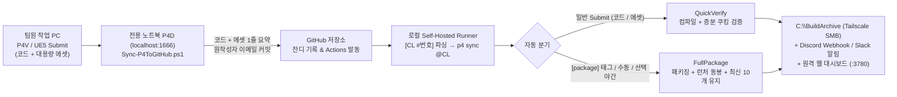

# 🛠️ BuildServerKit Studio `v2.1.3`

**여유 노트북(또는 전용 PC) 1대를 클릭 몇 번으로 Unreal Engine 5 올인원 빌드 서버로 만들어 주는 데스크톱 매니저**  
*Perforce 하이브리드 자동 미러링 · GUI 원클릭 P4 서버 세팅 · GitHub Actions Self-Hosted Runner · 팀원 GitHub 프로필 연동 · 패키지 자동 보관 정리 · Discord/Slack 리포트 · Tailscale 원격 웹 대시보드*

[-0078D6?style=flat-square&logo=windows&logoColor=white)](https://github.com/eruminyu/BuildServerKit/releases/latest)

[📦 **최신 포터블 `.exe` 다운로드**](https://github.com/eruminyu/BuildServerKit/releases/latest) · [🚀 **단계별 초기 세팅 튜토리얼**](#-단계별-초기-세팅-튜토리얼-초기-마법사-기준) · [👥 **팀원 PC 합류 가이드**](#-팀원-pc클라이언트-합류-가이드) · [📘 **Perforce 상세 레퍼런스**](./PERFORCE_SETUP_GUIDE.md)

---

## 💡 소개 & 전체 자동화 파이프라인

언리얼 엔진 5 팀 프로젝트에서 **대용량 바이너리 에셋(`.uasset`, `.umap`)은 로컬 Perforce로 안전하게 잠금 관리(`+l`)하고, 소스 코드·에셋 변경 요약은 GitHub로 자동 미러링(잔디 반영)해 로컬 초고속 패키징과 알림까지 연결**해 주는 올인원 도구입니다. *(기존 Git 단독 프로젝트 모드도 그대로 지원합니다.)*

---

## ✨ 주요 기능

* **✨ 최초 실행 5단계 설정 마법사 & PC 필수 요소 자동 진단:** 새 PC에서 처음 실행하면 **UE5(모든 `UE_5.*` 버전 자동 탐지) · Visual Studio C++(MSVC) · Git · Perforce(CLI/P4D·Unicode·티켓) · Tailscale · RAM/SSD 용량 · Runner** 상태를 실시간 진단하고, 부족한 요소는 공식 다운로드 또는 `winget` 원클릭 설치를 제공합니다. 이후에도 좌측 하단/대시보드의 **`[✨ 설정 마법사]`** 버튼으로 언제든 다시 열 수 있습니다.
* **⚡ Perforce 서버 GUI 설치 & 원클릭 자동 세팅 (터미널 불필요):** `[Perforce & 미러링]` 탭에서 최신 공식 Helix Core Server(`P4D`) 자동 다운로드·설치, `winget` `Perforce.P4V`(P4V+CLI) 설치, UAC Unicode 전환(`p4d -xi`), 방화벽 개방(`1666`/`3780`), GUI 관리자 로그인, 그리고 **Stream 디포 · UE5 Typemap(`+l`) · Read-Only `p4bot` 무기한 티켓 · 전용 워크스페이스 2개(`ws-build-full`/`ws-mirror-code`) · `.p4ignore` 원클릭 일괄 구성**을 지원합니다.
* **👥 팀원 & 계정 관리 탭 (GitHub 프로필 링크 자동 채우기):** 팀원의 GitHub 프로필 URL(`https://github.com/<아이디>`)만 붙여넣으면 아바타·이름·잔디용 이메일(비공개 이메일 계정은 공식 `{id}+{login}@users.noreply.github.com` 자동 생성)을 채워 **Perforce 계정 생성/수정 + `author_map.json` 저장 + 팀원용 P4V 접속 가이드 복사**까지 한 번에 처리합니다. 무료 플랜 5유저/20워크스페이스 한도와 임의 유저 자동생성 차단(`dm.user.noautocreate=2`)도 실시간 관리합니다.
* **🎨 아티스트 에셋 Submit 잔디 & 자동 쿠킹 검증:** `Content/` 대용량 바이너리는 GitHub에 올리지 않고, 수정된 에셋 이름을 `.p4-sync/asset_changelog.md`에 1줄 요약으로 기록해 **아티스트 GitHub 잔디와 자동 쿠킹 검증(`QuickVerify`)**을 모두 챙깁니다.
* **📦 패키징 빌드 보관 개수 제한 (기본 10개):** `[패키징 & 보관 관리]` 탭에서 **사용함/사용안함 토글 + 유지 개수 수정**이 가능하며, 전체 패키징 성공 시 GUI 수동 빌드와 GitHub Actions 양쪽 모두 최신 N개만 남기고 가장 오래된 패키징 폴더부터 자동 정리합니다.
* **💬 Discord Webhook & Slack 동시 리포트:** 성공/실패 Embed 알림과 실패 시 핵심 에러 발췌 + 원본 `.log` 자동 첨부 *(Discord 8MB 초과 시 자동 `.zip` 압축)*.
* **🌐 선택적 Tailscale 원격 웹 대시보드:** 토글 ON 시 `http://<Tailscale_IP>:3780`으로 팀원들이 브라우저에서 실시간 빌드 상태·콘솔·에러·패키지 목록을 열람할 수 있습니다 *(기본 읽기 전용, 모든 토큰·설정 원격 노출 차단)*.
* **🖥️ 24시간 서버용 트레이 상주:** 창 닫기(`✕`)를 누르면 종료 대신 **시스템 트레이로 최소화**되며, 트레이 아이콘 **한 번 클릭(싱글클릭)**으로 즉시 다시 열립니다 *(완전 종료: 트레이 아이콘 우클릭 → `완전 종료`)*.
* **🎮 30KB 초경량 게임 옵션 런처 (`_Launcher.exe`) 자동 동봉:** 패키징 완료 시 그래픽 프리셋·해상도·창모드(QHD/4K 렌더링 스케일 자동 보정) 런처를 함께 생성합니다.

---

## 🚀 단계별 초기 세팅 튜토리얼 (초기 마법사 기준)

> **권장 사양 (노트북 1대 올인원 기준):** Windows 10/11 · RAM 32GB (최소 16GB) · SSD 1TB · 유선 LAN + Tailscale

### 0단계: 시작 전 체크 (3분)
1. **노트북 24시간 서버 기본 설정:**
   * 제조사 유틸리티/BIOS에서 **배터리 최대 충전 50~80% 제한** (스웰링 방지).
   * 제어판 전원 옵션에서 **덮개를 닫았을 때: 아무것도 안 함**, **절전 모드: 안 함**.
   * **[Tailscale](https://tailscale.com/download/windows)** 설치 및 로그인.
2. **GitHub에 빈 저장소(Empty Repo) 1개 생성:**
   * 예: `eruminyu/Project_MurMur` (**Private** 권장)
   * `Add README`: **On** · `Add .gitignore`: **UnrealEngine** · `Add license`: **No license** *(비공개 팀 게임 프로젝트는 라이선스 없음이 정석)*
   * 생성 후 **`Settings → Collaborators`**에 팀원 GitHub 계정을 초대해 두세요.
   * **중요:** 작업 PC의 UE5 프로젝트는 GitHub로 직접 Push하지 말고, 아래 7단계에서 **Perforce에 먼저 Submit**합니다!
3. **[Releases](https://github.com/eruminyu/BuildServerKit/releases/latest)**에서 **`BuildServerKit_Studio_Portable.exe`**를 노트북의 원하는 폴더(예: `C:\BuildServerKit\`)에 다운로드해 실행합니다.

---

### 1단계: `1. PC 필수 진단`
처음 실행하면 **설정 마법사**가 자동으로 열립니다.
1. 상단 운영 방식을 **`Perforce 하이브리드 (권장)`**으로 확인합니다.
2. 9개 항목의 진단 결과를 확인하고 부족한 필수 프로그램(`✖ 필수 부족`)이 있다면 우측의 **`[⚡ winget 설치]`** 또는 **`[⬇ P4D 자동 다운로드·설치]`** 버튼으로 설치한 뒤 **`[↻ PC 환경 다시 검사]`**를 누릅니다.
   > **💡 무료 5유저 절약 팁:** Helix Core Server(`P4D`)를 처음 설치할 때 만드는 `super` 계정은 별도의 `admin`으로 낭비하지 말고 **관리자 + 본인 작업용 계정 1개로 겸용**하세요! (`본인(1) + 팀원(3) + p4bot(1) = 총 5명` 딱 맞춤)
3. **`[다음 단계 →]`** 클릭.

---

### 2단계: `2. 엔진 · 폴더 · 보관`
1. 자동 감지된 **Unreal Engine 5 경로**가 맞는지 확인합니다 (`ArchiveRoot` 기본값: `C:\BuildArchive`).
2. **패키징 보관 개수 제한** 토글 ON · 최대 유지 개수(기본 **`10`**)를 확인합니다.
3. **`[🛠 지금 폴더 & 스크립트 배치]`** 버튼을 눌러 `C:\BuildSystem\Scripts`, `C:\BuildArchive`, `C:\actions-runner`를 일괄 생성·배치합니다.
4. **`[다음 단계 →]`** 클릭.

---

### 3단계: `3. GitHub & Runner`
1. **`[▶ GitHub 로그인 & 저장소 선택]`** → PAT 발급(또는 `gh` CLI 원클릭 가져오기) 후 0단계에서 만든 빈 저장소를 선택해 연결합니다.
2. **`[★ build.yml 자동 등록]`** 클릭 *(커밋에 `[skip ci]`와 `paths-ignore`가 자동 적용되어 빈 프로젝트 상태에서 불필요한 빌드 실패가 뜨지 않습니다)*.
3. Self-Hosted Runner를 순서대로 클릭합니다:
   * **`[1] Runner 다운로드`** → **`[2] 저장소에 자동 등록`** → **`[3] ▶ Runner 가동 시작`** (배지가 초록색 **`가동 중 (Runner)`**으로 변경 확인).
4. **`[다음 단계 →]`** 클릭.

---

### 4단계: `4. Perforce / 에셋` (GUI 원클릭 서버 세팅)
1. 먼저 **`[1] 미러 Git 저장소 최초 Clone`**을 클릭해 빈 GitHub 저장소를 `C:\BuildSystem\P4MirrorRepo`에 내려받습니다.
2. 바로 아래 카드의 **`[Perforce 원클릭 세팅 열기 →]`**를 클릭해 `[Perforce & 미러링]` 탭 상단으로 이동합니다.
3. **A. 설치 · OS 설정:**
   * 아직 미완료된 항목이 있다면 **`[🔤 3. Unicode 활성화 (p4d -xi)]`**, **`[🛡 4. 방화벽 개방 (1666/3780)]`** 클릭 (UAC 승인).
4. **B. 관리자 로그인 & 원클릭 서버 일괄 구성:**
   * `관리자 Perforce 아이디`(본인 `super` 계정) + 비밀번호 → **`[🔑 로그인]`**
   * `프로젝트 Stream 디포 이름` 입력 (예: `Project_MurMur` / `main`)
   * `p4bot 비밀번호` → **`[🎲 자동생성]`** 클릭 (4인 팀 권장; 5인 팀이면 아래 `p4bot` 체크 해제)
   * **`[🚀 원클릭 일괄 자동 세팅 실행]`** 클릭! → 상단 10개 배지가 전부 초록색 **`✔`**로 바뀌면 서버 세팅 완료!
5. 좌측 하단 **`[✨ 설정 마법사 & PC 진단]`**으로 마법사를 다시 열어 **`5. 알림 & 완료`**로 이동합니다.

---

### 5단계: `5. 알림 & 완료`
1. **Discord Webhook URL** 및/또는 **Slack Bot Token + 채널 ID** 입력 후 **`[테스트]`** 버튼으로 알림 정상 수신을 확인합니다.
2. **Tailscale IP 자동 감지**를 확인하고, 팀원 브라우저 열람용 **원격 웹 대시보드** 토글을 켭니다 *(기본 읽기 전용)*.
3. **`[✔ 설정 완료하고 시작하기]`** 클릭!

---

### 6단계: `[팀원 & 계정 관리]` 탭에서 본인·팀원 등록 (GitHub 잔디 연결)

| 번호 | Perforce ID | 역할 | 권한 | 비고 |
| :---: | :--- | :--- | :--- | :--- |
| **1** | 본인 ID *(예: `p4murmur`)* | 관리자 + 본인 작업용 | `super` | 하단 표 **`[수정]`** → 본인 GitHub 링크 붙여넣고 저장 |
| **2~4** | 팀원 1~3 ID | 팀원 작업용 | `write` | GitHub 프로필 링크 입력 → 비밀번호 지정 후 저장 |
| **5** | **`p4bot`** | 노트북 자동화 전용 | `read` (무기한) | 4단계 원클릭 세팅에서 자동 생성됨 |

1. **본인 계정 잔디 연결:** 하단 목록에서 본인 ID 행의 **`[수정]`** 클릭 → 맨 위 칸에 본인 GitHub 프로필 링크(`https://github.com/아이디`) 붙여넣기 → **`[🔍 GitHub 정보 자동 채우기]`** → **`[✔ Perforce 계정 반영 + 잔디 매핑 동시 저장]`**.
2. **팀원 추가:** 팀원의 GitHub 링크 붙여넣기 → **`[🔍 GitHub 정보 자동 채우기]`** → 초기 비밀번호(8자 이상) 입력 → **`[✔ Perforce 계정 반영 + 잔디 매핑 동시 저장]`** → **`[📋 이 팀원용 P4V 접속 가이드 복사]`**로 팀원에게 바로 전달!
   * *(다음 팀원 링크를 바로 붙여넣어도 Perforce 아이디가 자동으로 다음 팀원으로 교체됩니다.)*

---

### 7단계: 작업 PC에서 빈 UE5 프로젝트 최초 Submit → 첫 자동화 확인
1. 작업 PC에서 **P4V**로 `<노트북_Tailscale_IP>:1666` (본인 ID, 인코딩 **`UTF-8`**, Stream `//Project_MurMur/main`)에 워크스페이스를 생성합니다.
2. 워크스페이스 폴더 안에 빈 UE5 프로젝트와 `.p4ignore`를 넣고 P4V에서 **`Mark for Add` → `Submit`** (`CL #1`).
3. 노트북 `BuildServerKit Studio`의 **`[Perforce & 미러링]` 탭**에서 **`[▶ 지금 1회 미러링 실행]`** 클릭!
   * GitHub에 `[CL #1]` 커밋 & 잔디 생성 → Actions 자동 발동 → 노트북 Runner가 `localhost:1666`에서 `CL #1` 전체를 동기화해 **`QuickVerify`** 실행 → Discord/Slack 알림 도착!
4. 정상 동작 확인 후 **`[Windows 작업 스케줄러 등록]`**(또는 앱 내장 자동 미러링 타이머 ON)과 **`[매일 새벽 백업 스케줄러 등록]`**을 켜두면 완전 무인 운영 준비 완료!

---

## 👥 팀원 PC(클라이언트) 합류 가이드

팀원 PC에는 `BuildServerKit Studio`나 Git을 설치할 필요가 없으며, 아래 **2가지만 설치**하면 됩니다.

1. **[Tailscale](https://tailscale.com/download/windows)** 설치 후 관리자가 초대한 네트워크에 로그인.
2. **[Helix Visual Client (P4V)](https://www.perforce.com/downloads/helix-visual-client-p4v)** 설치 후 접속:
   * **Server:** `<노트북_Tailscale_IP>:1666`
   * **User:** 관리자가 발급한 본인 P4 ID
   * **Character Encoding:** **`UTF-8`** *(필수)*
   * **Workspace:** `New...` → Stream `//Project_MurMur/main` 선택 → 로컬 작업 폴더 지정 (`rmdir` 체크 권장) → **`Get Latest Revision`**
3. **UE5 에디터 내장 연동 (아티스트·기획자 권장):**
   * 에디터 우측 하단 **`Revision Control` → `Perforce`** 선택 후 위와 동일한 Server·User·Workspace 입력 → 수정 시 자동 독점 잠금(`+l`)!
4. **일상 빌드 & 결과물 확인:**
   * 일반 Submit (코드/에셋 모두) → 자동 **`QuickVerify`** (컴파일 + 증분 쿠킹 검증)
   * Submit 설명에 **`[package]`** 또는 **`[release]`** 포함 → 자동 **`FullPackage`** (`.pak` + 옵션 런처 동봉 + 최신 10개 자동 유지)
   * **실시간 빌드 현황(브라우저):** `http://<노트북_Tailscale_IP>:3780`
   * **완성 패키지·로그 다운로드(탐색기):** `\\<노트북_Tailscale_IP>\BuildArchive` *(노트북에서 `C:\BuildArchive` 네트워크 공유 활성화 시)*

---

## 🧹 트레이 상주 & 다른 팀 배포 시 초기화 (`Factory Reset`)

* **창 닫기(`✕`):** 24시간 서버 용도로 기본 **시스템 트레이 최소화**로 동작합니다. 트레이 아이콘을 **한 번 클릭**하면 다시 열리며, 완전 종료는 **트레이 아이콘 우클릭 → `완전 종료`**를 사용하세요.
* **클린 배포 초기화:** 다른 팀이나 새 PC로 전달하기 전에 `[알림 · 네트워크 · 설정]` 탭 최하단의 **`[전체 초기화 실행 (Factory Reset)]`**을 누르면 모든 개인 토큰·경로와 `SetupCompleted` 플래그가 삭제되어 다음 PC에서 설정 마법사가 깨끗하게 자동 시작됩니다.

---

## 📦 폴더 구성 & 소스에서 직접 실행/빌드

| 파일 / 폴더 | 역할 |
| :--- | :--- |
| **`app/`** | **BuildServerKit Studio** Electron 데스크톱 앱 + 내장 Tailscale 원격 웹 대시보드 소스 |
| **`launch_app.bat`** | 소스에서 의존성 자동 확인 후 앱 바로 실행 |
| **`build_app.bat`** | 단일 포터블 실행 파일(`app\dist\BuildServerKit_Studio_Portable.exe`) 빌드 |
| **`Sync-P4ToGitHub.ps1`** | 워터마크 순차 처리 P4 → GitHub 코드 & 에셋 1줄 요약 자동 미러링 스크립트 |
| **`github_workflow_p4_build.yml`** | Perforce 하이브리드 전용 GitHub Actions 워크플로우 템플릿 (야간 빌드 선택 옵션) |
| **`github_workflow_build.yml`** | 기존 Git 단독 모드용 GitHub Actions 워크플로우 템플릿 |
| **`Run-UEBuild.ps1`** | UE5 빌드·쿠킹·패키징 + 패키지 보관 개수 자동 정리 + 런처 동봉 + 알림 호출 |
| **`Send-DiscordReport.ps1`** / **`Send-SlackReport.ps1`** | Discord Webhook & Slack Bot 결과 리포트 + 에러 원본 로그 첨부 업로드 |
| **`Backup-P4Server.ps1`** | Perforce 새벽 체크포인트 생성 + `robocopy`/`rclone` 외부 백업 + 구형 파일 정리 |
| **`Init-BuildPC.ps1`** | `C:\BuildSystem` / `C:\BuildArchive` 초기 디렉토리 및 스크립트 일괄 배치 |
| **`PERFORCE_SETUP_GUIDE.md`** | 노트북 서버화·Perforce CLI 레퍼런스 상세 가이드 |
| **`UE_BuildManager.exe` / `.cs`** | 게임 패키징 동봉용 30KB 초경량 `_Launcher.exe` 생성기 (및 레거시 WinForms 매니저) |

---

## 📄 라이선스

이 프로젝트는 [MIT License](./LICENSE)에 따라 배포됩니다.
